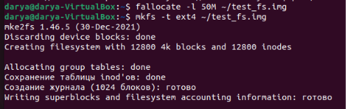
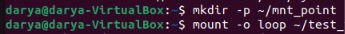
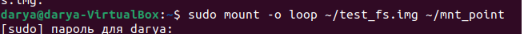
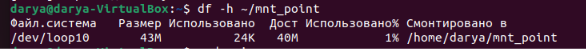
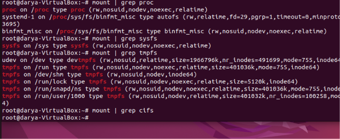
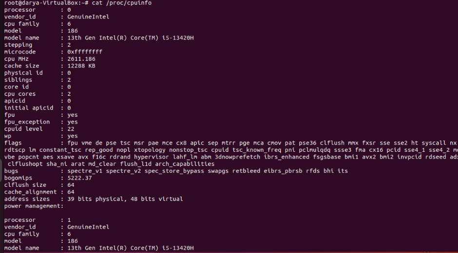
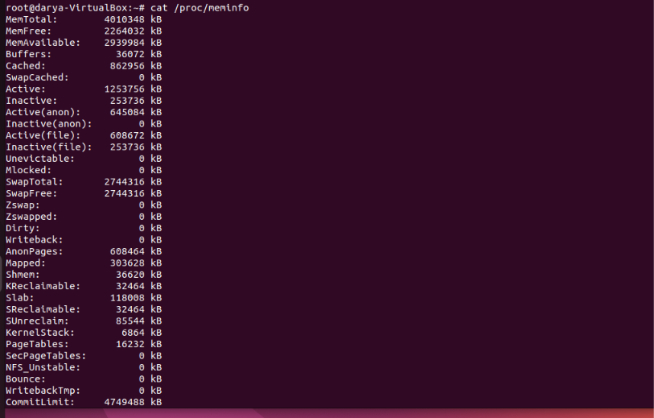
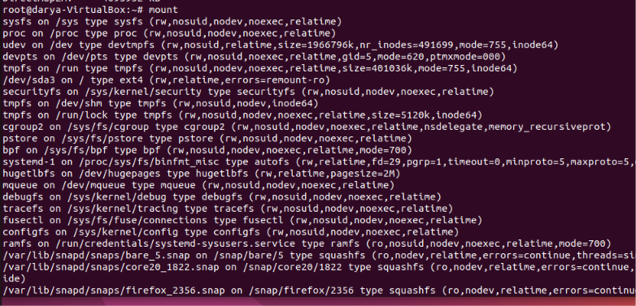
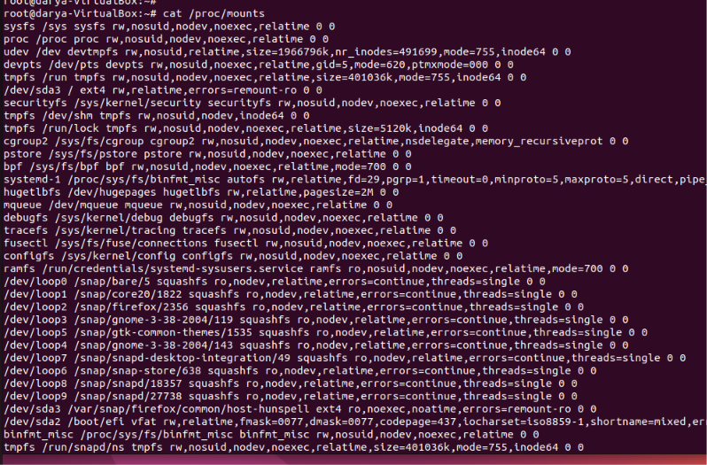

### 1) Какие файловые системы вы знаете?
FAT, NTFS (Windows), APFS (Apple), Ext4 (Linux).
### 2) Как можно классифицировать файловые системы? В чём основные отличия?
По механизму обеспечения надежности:

Журналируемые. Отличается повышенной надежностью, эта фс гарантирует сохранность ваших данных. Все действия пользователя и системы записываются в специальный журнал, что не только позволяет отслеживать историю изменений и диагностировать неполадки, но и обеспечивает целостность данных даже в случае внезапного сбоя.
Не журналируемые. Нет записи историй действий, нет гарантий сохранности информации.
По cтруктуре метаданных:

Табличные. Простая и универсальная структура, где вся информация хранится в линейных таблицах. Не поддерживает сложные метаданные или разграничение прав доступа, но обеспечивает максимальную совместимость между различными операционными системами.
Древовидные. Современная и высокопроизводительная организация данных, использующая сбалансированные деревья для хранения информации. Обеспечивает быстрый поиск файлов и эффективность при работе с большими директориями.
На основе inode (индексных дескрипторов). Отличается структурой, где каждому файлу присваивается уникальный идентификатор. Все данные организованы в строгой иерархии, что гарантирует стабильную производительность и предсказуемое поведение даже при высоких нагрузках.
По назначению:

Локальные - для локального хранения данных на жёстких дисках.
Сетевые - для удаленного доступа к файлам.
Виртуальные - представляют данные о системе в виде файлов.
### 3) Какие файловые системы обычно используются в Linux?
Ext (Extended FS)
Первый вариант расширенной файловой системы, появившийся в 1992 году. На сегодняшний день считается устаревшей и практически не используется в современных системах.

Ext2
Вторая версия расширенной файловой системы, выпущенная в 1993 году. Сохранила базовую структуру Ext, но получила улучшенный интерфейс и настройки. Объем памяти и производительность были увеличены, максимальный размер файла достиг 2 ТБ. Из-за ограниченной функциональности в настоящее время применяется редко.

Ext3
Третье поколение Extended FS, представленное в 2001 году. Стала первой журналируемой файловой системой в этом семействе. Ведутся логи изменений — все операции с файлами предварительно записываются в специальный журнал. Это позволяет восстанавливать данные после сбоев благодаря встроенным алгоритмам восстановления.

Ext4
Четвертая версия Extended FS, выпущенная в 2006 году. В ней устранены многие ограничения предыдущих поколений. На сегодняшний день является стандартной файловой системой для большинства дистрибутивов Linux. Не считается инновационной, но обеспечивает высокую стабильность и надежность работы. Широко применяется в Unix-системах.

XFS
Еще один представитель журналируемых файловых систем. Особенность — журналирование только метаданных. Отличается высокой скоростью работы с большими файлами и отложенным выделением места. Поддерживает увеличение размеров разделов, но не позволяет их уменьшать. Существует риск потери данных при внезапном отключении питания.

Btrfs
Современная файловая система с повышенной отказоустойчивостью и производительностью. Удобна в использовании, предоставляет возможности восстановления данных и создания мгновенных снимков (снапшотов). Разделы можно динамически изменять в процессе работы без остановки системы.
### 4) Как создать файловую систему на блочном устройстве?
Поскольку в моей системе отсутствует второй физический диск (/dev/sdb), для безопасной демонстрации был создан файл-образ ~/test_fs.img размером 50 МБ с помощью утилиты fallocate. Команда mkfs -t ext4 успешно инициализировала на этом файле структуру файловой системы ext4. 

### 5) Что такое монтирование и как подключить файловую систему в систему?
Монтирование — это процесс присоединения файловой системы к определенной точке в системе (каталогу), чтобы получить доступ к данным. Для того чтобы подключить диск к системе надо создать точку монтирования ( при помощи mkdir) и смонтировать диск при помощи команды mount. Далее при вызове команды df -h (команда показывает информацию о дисках) будет видно куда смонтирован наш диск:

### 6) Рассмотрите `procfs`, `sysfs`, `tmpfs` и `cifs`.
   6.1) В чём особенности каждой из них?
   6.2) Найдите в своей системе каталоги, куда примонтированы эти файловые системы, если они используются.
##### 6.1) 
procfs (Process File System) — виртуальная файловая система, которая предоставляет доступ к информации о процессах и параметрах ядра. Смонтирована в каталоге /proc. Например, через неё можно получить данные о процессоре и памяти (/proc/cpuinfo, /proc/meminfo).

sysfs (System File System) — виртуальная файловая система, через которую можно получить информацию об устройствах, драйверах и модулях ядра. Смонтирована в каталоге /sys.

tmpfs (Temporary File System) — временная файловая система, хранящая данные в оперативной памяти (RAM). Обычно используется для каталогов /run, /tmp, /dev/shm. После перезагрузки её содержимое удаляется.

cifs (Common Internet File System) — сетевая файловая система, предназначенная для подключения общих папок по протоколу SMB (например, к ресурсам Windows или Samba-сервера). Точка монтирования задаётся пользователем (например, /mnt/share).
##### 6.2)
Чтобы вывести каталоги, к которым эти файловые системы примонтированы, можно использовать команду mount c grep для того чтобы найти строки с нужным текстом (названием файловой системы):

(Команда mount | grep cifs ничего не вернула т.к. сетевые папки не смонтированы.)
### 7) Как получить информацию о системе, используя содержимое виртуальных файловых систем?
   7.1) выведите информацию о процессоре;
   7.2) выведите информацию о состоянии памяти.
   
   В Linux команда cat используется для чтения содержимого файлов, а так как почти вся системная информация хранится в виртуальных файлах внутри каталогов /proc и /etc, с помощью cat их можно просто вывести на экран. 
##### 7.1) Информация о процессоре хранится в файле /proc/cpuinfo. 

##### 7.2) Для вывода информации о состоянии памяти используется файл /proc/meminfo:

### 8) Выведите список всех текущих точек монтирования минимум двумя разными способами.
1. Команда mount
Классический способ. Выводит список всех смонтированных ФС с указанием типа и опций монтирования.

2. Файл /proc/mounts
Этот файл содержит актуальную информацию о монтировании напрямую из ядра. Он часто более точен, чем вывод команды mount, так как не зависит от пользовательских утилит.
