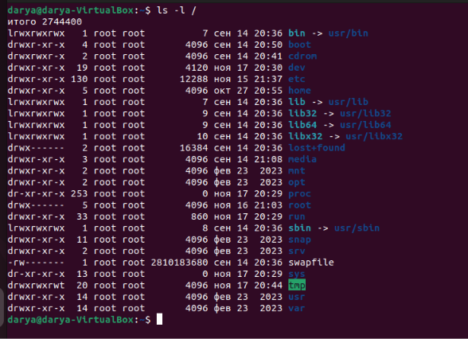
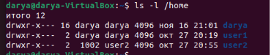
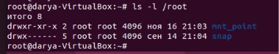
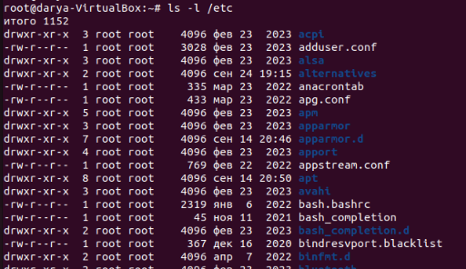
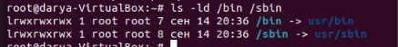
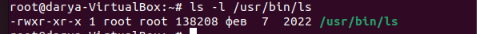

### 1) Какая структура каталогов используется в Linux? Выведите список объектов в корне системы.
В Linux используется древовидная структура каталогов, где корень / содержит все системные каталоги (/bin, /etc, /home, /var и т.д.), организованные по функциональному назначению. Вывод списка файлов в корне системы:

### 2) Где обычно хранятся домашние каталоги обычных пользователей?
Папки пользователей хранятся в каталоге /home/.

### 3) Где находится домашний каталог суперпользователя?
Домашний каталог суперпользователя находится в /root/.

### 4) Где обычно хранятся основные системные конфигурационные файлы?
Основные конфигурационные файлы системы хранятся в каталоге /etc/.

### 5) Объясните назначение каталогов:
   - `/bin`
   - `/sbin`
   - `/usr/bin`
   - `/usr/sbin`
   - `/etc`
   - `/var`
   - `/tmp`
   - `/home`
   - `/root`
   - `/proc`
   - `/sys`
В Linux системные каталоги организованы по функциональному назначению
/bin — бинарные исполняемые файлы, необходимые для работы системы в однопользовательском режиме и базовых команд пользователя (ls, cp, bash). 
/sbin — системные бинарные файлы, используемые администратором (fdisk, ifconfig, mkfs). 
/usr/bin — основная масса пользовательских исполняемых файлов, устанавливаемых пакетами (python3, nano, git).
/usr/sbin — основная масса системных утилит администрирования (sshd, useradd).
/etc — системные конфигурационные файлы (текстовые, редактируемые администратором): /etc/passwd, /etc/fstab, /etc/ssh/.
/var — переменные данные, растущие со временем: логи (/var/log), очереди печати, базы пакетов (/var/cache).
/tmp — временные файлы, обычно очищаются при перезагрузке. 
/home — домашние каталоги обычных пользователей (/home/darya).
/root — домашний каталог суперпользователя.
/proc — виртуальная файловая система procfs, интерфейс к процессам и ядру.
/sys — виртуальная файловая система sysfs, интерфейс к устройствам и драйверам.

### 6) Проверьте, являются ли `/bin` и `/sbin` реальными каталогами или символическими ссылками в вашей системе.
Вывод показывает, что /bin и /sbin не являются реальными каталогами, а представляют собой символические ссылки (на что указывает первый символ l в правах доступа и стрелка ->). Они указывают на /usr/bin и /usr/sbin соответственно.

### 7) Найдите, где физически расположен исполняемый файл одной из команд, которой вы пользовались ранее.
Команда which определила путь к исполняемому файлу — /usr/bin/ls. Команда ls -l показала его атрибуты: первый символ - в строке прав доступа (-rwxr-xr-x) указывает на то, что это обычный файл (а не каталог d или символическая ссылка l). Файл принадлежит пользователю root, группе root, имеет размер 138 208 байт и был создан 7 февраля 2022 года.
