### 1) Выведите содержимое `/etc/fstab`. Что хранится в этом файле?
В файле fstab содержится информация о дисках, разделах и точках монтирования.
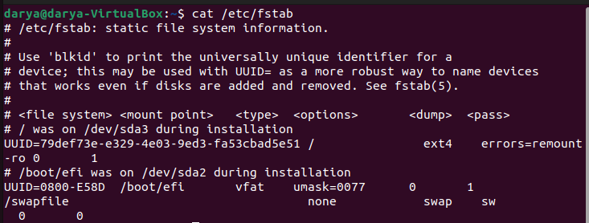
### 2) Добавьте в виртуальную машину ещё один виртуальный диск.
С помощью Virtual Box создала диск LinuxUbuntu_1.vdi.
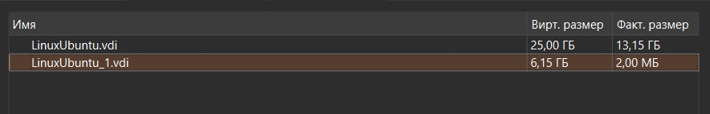
### 3) Определите, как система видит новый диск, и выведите информацию о блочных устройствах.
Чтоб вывести информацию о дисках можно использовать команду lsblk:
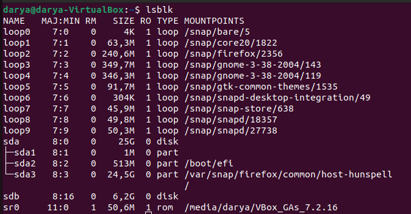
Новый диск отображается в таблице (sdb).
### 4) Создайте на новом диске таблицу разделов и один раздел.
Создаю таблицу разделов с помощью fdisk, настраиваю её:
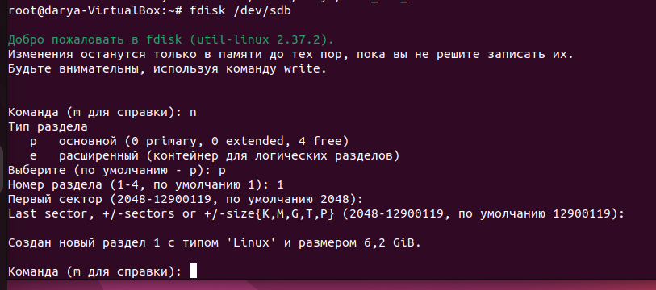
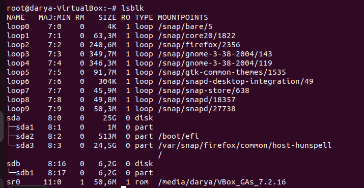
### 5) Создайте на разделе файловую систему ext4.
Создаю файловую систему при помощи команды mkfs ext4 — тип файловой системы, /dev/sdb1— раздел на диске, где будет создана файловая система):
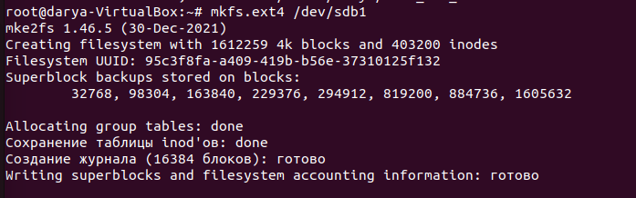
## 6) Создайте отдельный каталог в `/mnt` и примонтируйте туда файловую систему.
Смонтировать диск можно при помощи команды mount. Далее при вызове команды df -h (команда показывает информацию о дисках) будет видно куда смонтирован наш диск:
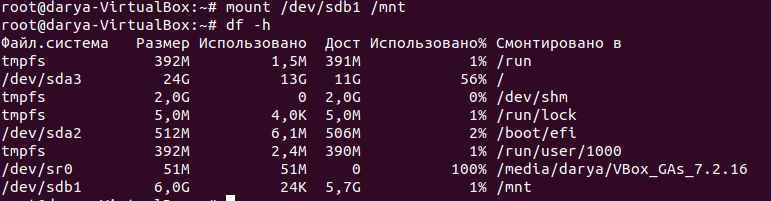
### 7) Создайте на примонтированном диске несколько файлов.
Создаю файл test.txt.
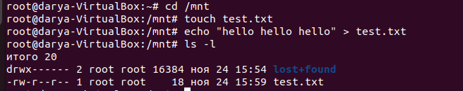
### 8) Отмонтируйте диск и проверьте, видны ли созданные файлы через каталог монтирования. Объясните результат.
Отмонтирую диск при помощи команды umount, потом примонтирую его обратно при помощи команды mount, файл остался в целости.
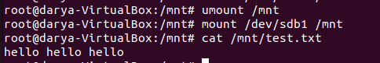
### 9) Настройте автоматическое монтирование файловой системы при загрузке через `/etc/fstab`.
При помощи команды blkid получаю UUID нового раздела:

Далее добавляю в файл /etc/fstab информацию о диске:

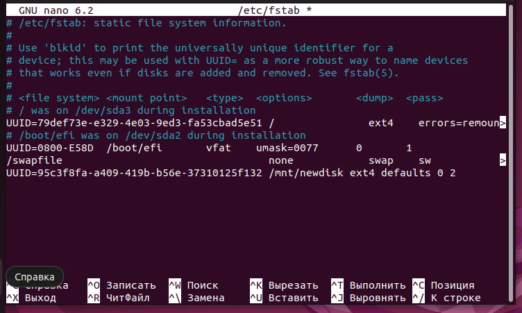
### 10) Для записи в `/etc/fstab` используйте UUID файловой системы, а не имя вида `/dev/sdX`.
В конец файла успешно добавлена строка:
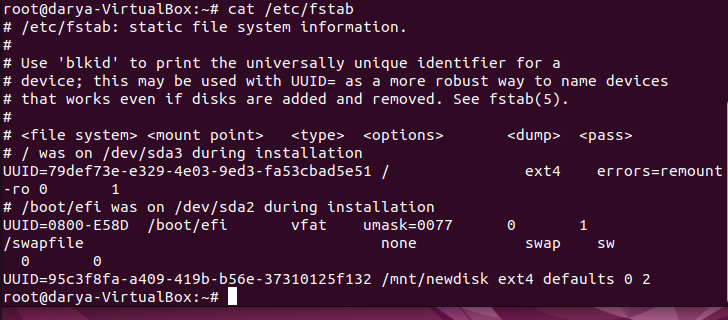
### 11) Проверьте корректность `/etc/fstab` до перезагрузки.
Проверяю корректность моего монтирования при помощи команды mount -a, командой findmnt вывожу информацию о ФС, смонтированной в mnt:
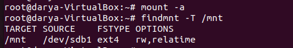
### 12) Перезагрузите систему и убедитесь, что файловая система примонтирована автоматически.
После перезагрузки проверяю диски и созданный файл
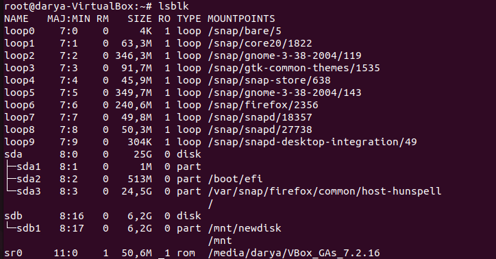
Файловая система активна и доступна для чтения/записи.
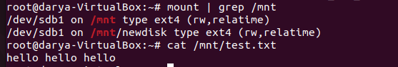
Файл, созданный ранее (в пункте 7), успешно сохранился и доступен после перезагрузки. Это подтверждает, что данные лежат именно на новом диске, а не в оперативной памяти.