# RAID-массивы

### 1) Что такое RAID и какие основные уровни RAID вы знаете?
RAID (Redundant Array of Independent Disks) — технология объединения нескольких физических дисков в один логический для повышения производительности, отказоустойчивости или объёма хранилища.

Виды RAID:
RAID 0 (Striping — чередование). Данные разделяются на блоки и равномерно распределяются («располосовываются») между всеми дисками в массиве. Минимум дисков - 2.
RAID 1 (Mirroring — зеркалирование). Данные записываются одновременно на оба диска — создаётся точная копия («зеркало»). Минимум дисков - 2.
RAID 5 (Striping с контролем чётности) Данные и информация для восстановления (паритет) распределяются между всеми дисками. Паритет позволяет восстановить данные при выходе одного диска. Минимум дисков - 3.
RAID 6 (Striping с двойным паритетом). Аналог RAID 5, но с двумя блоками паритета. Позволяет выдержать одновременный отказ двух дисков. Минимум дисков - 4.
RAID 10 (RAID 1+0 — зеркалирование + чередование). Сочетает RAID 1 и RAID 0: сначала создаются зеркала (RAID 1), затем они объединяются в полосу (RAID 0). Минимум дисков - 4.
### 2) Добавьте в виртуальную машину два дополнительных диска.
Из прошлого задания остался диск LinuxUbuntu_1.vdi уже с нужными настройками , создаем новый диск LinuxUbuntu_2.vdi
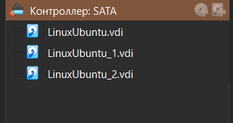
### 3) На двух дисках создайте RAID0-массив средствами Linux software RAID.
Создаю раздел диска sdc:
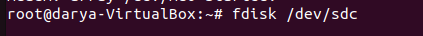
Cоздаю RAID 0 массив (--level=0 — RAID 0 (чередование/striping).
/dev/md0 — имя программного RAID-устройства):
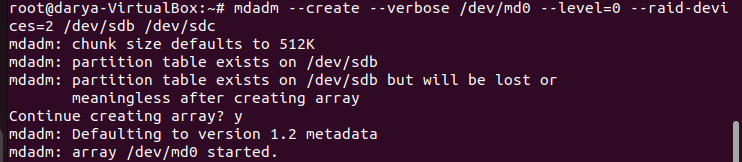
### 4) Проверьте состояние массива.
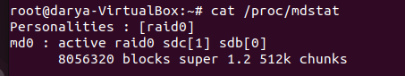
### 5) Создайте файловую систему ext4 уже на RAID-устройстве и примонтируйте её.
- mkfs.ext4 /dev/md0 команда форматирует блочное устройство RAID-массива /dev/md0 в файловую систему ext4. Система выделяет блоки, inode и создаёт журнал транзакций. В выводе виден UUID новой ФС.
- mkdir -p /mnt/raid0 создаю директорию /mnt/raid0, которая будет служить точкой монтирования. Ключ -p позволяет создавать родительские директории, если их нет, и не выдаёт ошибку, если папка уже есть.
- mount /dev/md0 /mnt/raid0 команда монтирует файловую систему с устройства /dev/md0 в каталог /mnt/raid0. После этого содержимое массива становится доступным через этот путь.
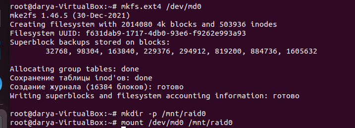
Результат проверки
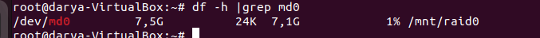
### 6) Запишите на массив тестовые файлы.
Создаю текстовые файлы с тестовым содержимым. Создаю бинарный файл размером 50 МБ (50 блоков по 1 МБ), заполненного нулями, для проверки записи больших объёмов данных на массив
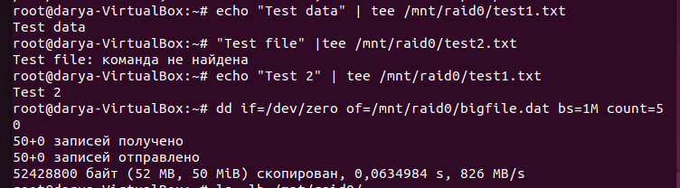
Тестовые файлы успешно записаны на RAID-массив и имеют корректный размер.
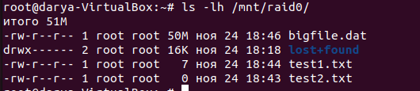
### 7) Удалите RAID0 и создайте RAID1.
Останавливаю RAID 0 и очищаю суперблоки на обоих разделах:
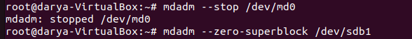
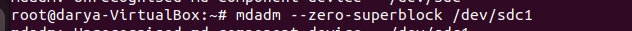
Создаю RAID 1(--level=1 — RAID 1 (чередование/striping).
/dev/md0 — имя программного RAID-устройства):
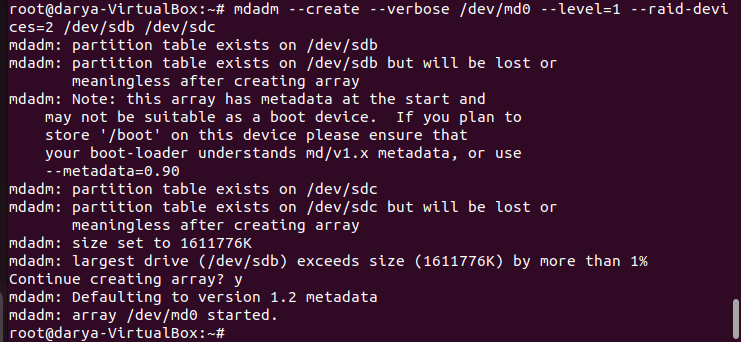
### 8) Создайте файловую систему на RAID1 и снова проверьте чтение/запись.
- mkfs.ext4 /dev/md0 - форматирование RAID1-массива в файловую систему ext4 

- mount /dev/md0 /mnt/raid0 - монтирование массива в точку /mnt/raid0 для доступа к данным
- echo "RAID1 TEST" | tee /mnt/raid0/raid1_test.txt - Создание тестового файла с записью "RAID1 TEST" и выводом содержимого на экран
- cat /mnt/raid0/raid1_test.txt - вывод содержимого файла для подтверждения целостности данных
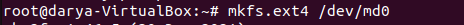
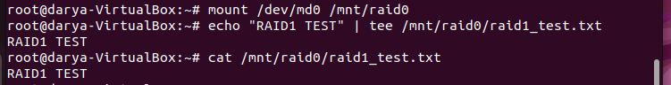
### 9) В чём практическая разница между RAID0 и RAID1?
RAID0 и RAID1 решают противоположные задачи. RAID0 (Striping) объединяет диски в один логический том, распределяя данные блоками по всем устройствам. Это обеспечивает максимальную скорость чтения и записи, а также суммирует объём всех дисков. Однако у него нет отказоустойчивости: выход из строя даже одного диска приводит к полной потере всех данных. RAID0 подходит для временных файлов, кэша или задач, где важна только производительность.
RAID1 (Mirroring) создаёт точную копию (зеркало) данных на каждом диске. Полезный объём массива равен объёму одного диска, а скорость записи не выше, чем у одиночного диска (так как данные нужно записать дважды). Зато RAID1 обеспечивает высокую надёжность: при отказе одного диска массив продолжает работать в деградированном режиме, и все данные остаются доступными. RAID1 используется для системных разделов, баз данных и хранения критически важной информации.
### 10) Имитируйте отказ одного диска RAID1:
####    10.1) пометьте диск как неисправный;
Команда сообщает контроллеру RAID, что диск sdc больше не может использоваться. Массив переходит в деградированный режим, но продолжает работать на оставшемся диске sdb.
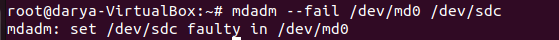
####    10.2) удалите его из массива;
Диск исключается из активного состава массива. Теперь RAID1 работает только на одном диске (sdb).
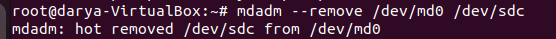
####    10.3) убедитесь, что данные остаются доступны.
Убедимся, что массив жив и файлы на месте:
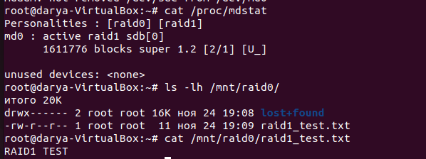
### 11) Верните диск в массив или добавьте новый и наблюдайте процесс восстановления.
1. Добавить диск обратно в массив
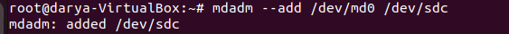
2. Наблюдать за процессом восстановления
Команда watch будет обновлять вывод каждую секунду.
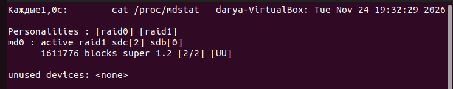
### 12) Какие файловые системы могут самостоятельно обеспечивать функции, похожие на RAID?
Некоторые современные файловые системы реализуют функции, аналогичные RAID, на уровне самой ФС, без необходимости использования mdadm:
ZFS: Поддерживает RAID-Z (аналог RAID5/6), зеркалирование (RAID1) и страйпинг (RAID0) нативно. Обеспечивает целостность данных через контрольные суммы и автоматическое восстановление (self-healing).
Btrfs: Имеет встроенную поддержку RAID0, RAID1, RAID5/6 (экспериментально) и RAID10. Также обеспечивает checksumming и возможность восстановления повреждённых данных из зеркал.
ReFS (Windows): Реализует функцию "Mirror Accelerated Parity" и устойчивость к битовому гниению, но менее гибка в настройке уровней RAID по сравнению с ZFS/Btrfs.
Эти ФС объединяют управление данными и отказоустойчивость в едином слое, что упрощает администрирование, но требует больше ресурсов CPU/RAM.
### 13) Можно ли создать RAID во время установки Linux?
Большинство дистрибутивов (Ubuntu, Debian, RHEL, CentOS) и в том числе ALT Linux позволяют создать RAID-массив прямо в установщике: при ручной разметке дисков есть пункт «Configure software RAID», где выбирают уровень (0, 1 и др.) и диски.