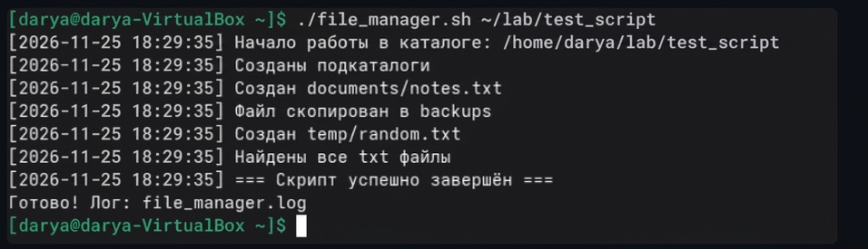
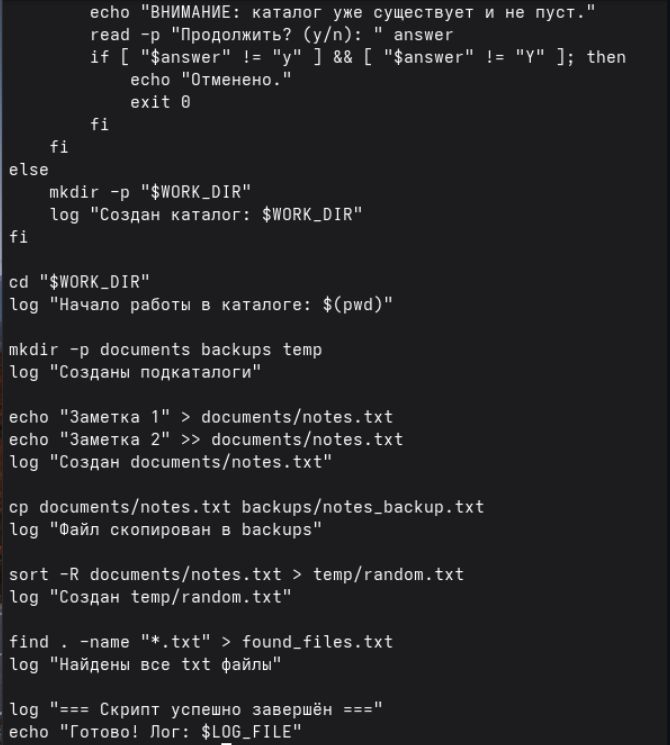

# Скриптуем по полной

### 1) Что такое shebang?
shebang - это первая строка в скрипте, которая сообщает системе, какой интерпретатор нужно использовать для выполнения этого файла.
### 2) Обязательно ли исполняемый файл должен иметь расширение `.sh`?
Нет, не обязательно, главное, чтоб в файле был шебанг и чтоб у файла были установлены разрешения на выполнения.
### 3) Напишите скрипт, который автоматически выполняет основные действия из блока «Работа с файлами».
#### 3.1) Скрипт должен использовать `set -euo pipefail`.
#### 3.2) Объясните назначение каждого из этих параметров.
- -e (errexit): Скрипт немедленно завершается, если любая команда возвращает ненулевой код (ошибку). Без этого флага bash по умолчанию игнорирует ошибки и идёт дальше.
- -u (nounset): Скрипт завершается с ошибкой, если вы пытаетесь использовать переменную, которая не была определена. Это защищает от опечаток в именах переменных.
- -o pipefail: В конвейере команд (например, cmd1 | cmd2 | cmd3) код возврата всего конвейера равен коду возврата последней команды. С этим флагом код возврата будет равен коду первой упавшей команды в цепочке. Это позволяет ловить ошибки в начале длинных конвейеров.
#### 3.3) Каталог для работы должен передаваться первым аргументом скрипта.
Буду использовать переменную $1, которая содержит первый аргумент, переданный при запуске.
#### 3.4) Если аргумент не передан — скрипт должен завершаться с понятной ошибкой и ненулевым кодом возврата.
Проверка $# (количество аргументов). Если оно равно 0, выводим сообщение в stderr и делаем exit 1.
#### 3.5) Повторный запуск скрипта не должен уничтожать уже существующие данные без предупреждения.
Вместо удаления (rm -rf) или перезаписи, буду проверять существование файлов/каталогов через if [ -d ... ] или if [ -f ... ]. Если они есть — логирую это, не трогаю их. Создание новых файлов через touch или echo >> (дописывание) безопасно.
#### 3.6) Основные действия скрипта должны записываться в лог-файл.
Создаю функцию log(), которая пишет timestamp + сообщение и в терминал (через tee), и в файл лога.

### 4) Покажите код возврата успешно завершившегося скрипта и скрипта, завершившегося с ошибкой.

