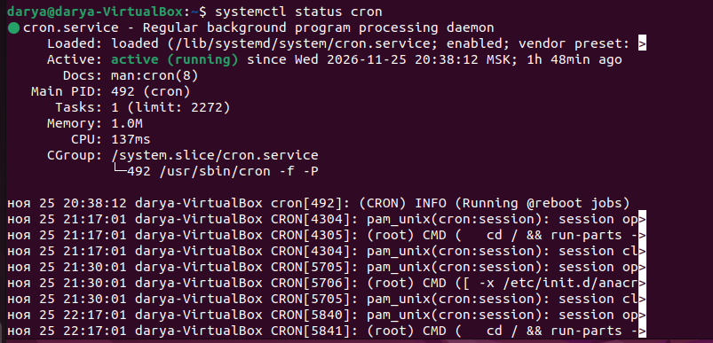
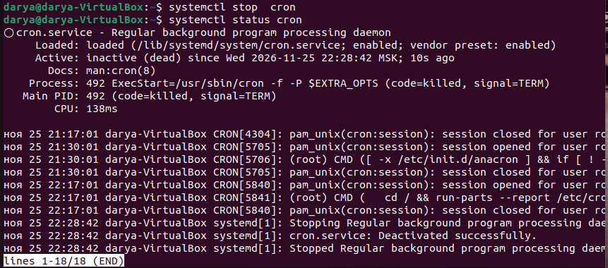
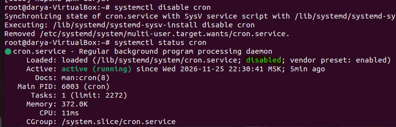
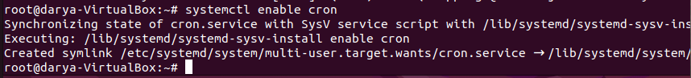
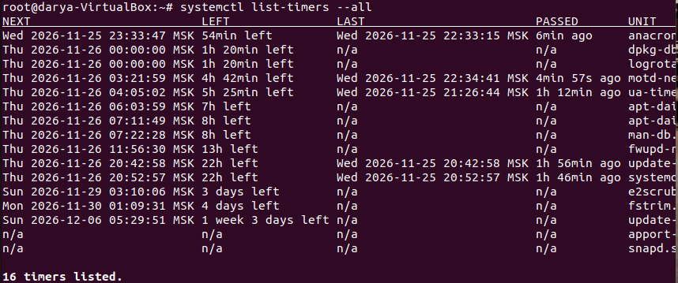
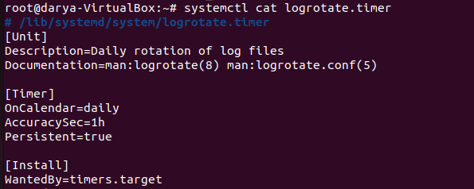

# Юниты

### 1. Что такое systemd unit?
Systemd unit (юнит) — это базовый объект, которым управляет systemd. Это конфигурационный файл с расширением 
(например, .service, .timer, .socket, .mount), который описывает ресурс, службу или точку монтирования, 
а также правила их работы в системе.

### 2. Проверьте статус любого systemd unit. Какую информацию выводит эта команда?
```shell
systemctl status cron
```

* Loaded: Путь к файлу юнита и статус автозагрузки (enabled или disabled).
* Active: Текущее состояние (active (running) или inactive (dead)), а также время, прошедшее с момента запуска.
* Main PID: Идентификатор главного процесса службы.
* Tasks / Memory: Количество потоков и объем потребляемой оперативной памяти.
* CGroup: Иерархия процессов, относящихся к этому юниту.
* Журнал (Logs): Последние 10-15 строк логов этой службы, что критически важно для диагностики.

### 3. Остановите выбранный сервис.
```shell
sudo systemctl stop crond
```


После остановки сервиса, при выводе информации об этом сервисе в строке Active будет inactive (dead).
### 4. Запустите его снова.
```shell
sudo systemctl restart cron
```
Команда systemctl restart - перезапускает сервис

### 5) Уберите сервис из автозагрузки.
Команда systemctl disable - отключает автозагрузку. После этого при выводе информации об этом сервисе в строке Loaded будет disabled.

### 6) Верните его в автозагрузку.
Команда systemctl enable - включает автозагрузку. После этого при выводе информации об этом сервисе в строке Loaded будет enabled.


### 7) Чем отличаются состояния `active`, `enabled`, `disabled`, `failed`?
* active - Служба запущена и работает прямо сейчас.
* inactive - Служба остановлена прямо сейчас.
* enabled - Служба будет запущена автоматически при следующей загрузке системы.
* disabled - Служба не будет запущена автоматически при загрузке (но её можно запустить вручную).
* failed - Служба попыталась запуститься, но завершилась с ошибкой.
### 8) Что такое systemd timers?
systemd timers - это механизм планирования задач, альтернатива классическому cron. Таймеры (.timer) запускают соответствующие юниты по расписанию. Преимущества перед cron: интеграция с журналом systemd (journalctl), возможность запускать задачи относительно событий (например, через 5 минут после загрузки).
### 9) Найдите хотя бы один существующий timer в системе и определите, какой unit он запускает.
Список всех таймеров в системе:
```shell
systemctl list-timers --all
```


Таймер logrotate.timer запускает сервис logrotate.service.

