# Пишем юниты

### 1) Создайте скрипт, который создаёт каталог и четыре файла с именами `1`, `2`, `3`, `4`.
###### В файлы запишите соответственно: текущую дату; версию ядра;имя компьютера; список файлов в домашнем каталоге пользователя, от которого выполняется скрипт. Не забудьте проверять существование каталогов и файлов.
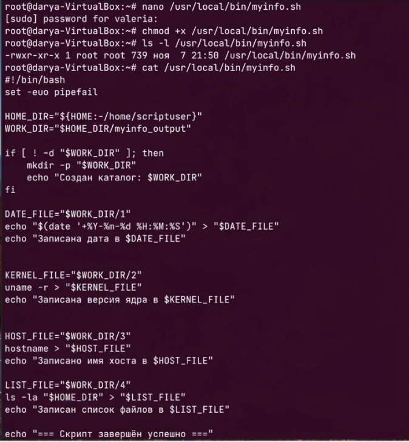

### 2) Создайте systemd service, который запускает этот скрипт. Проверьте его работу.
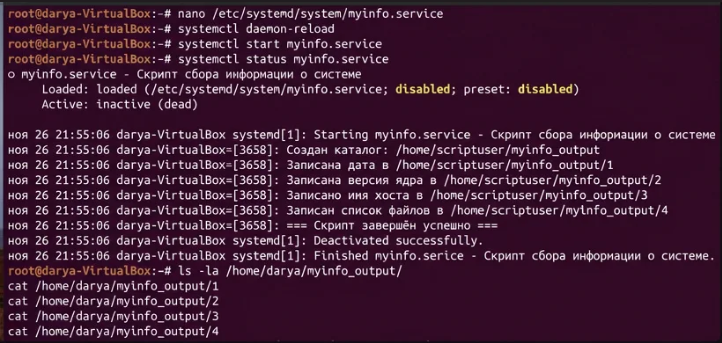
### 3) Создайте timer, который запускает этот service каждые 5 минут.
Откроем файл script.timer и настроим его: OnCalendar=*:0/5 - запускает юнит каждые 5 минут, Persistent=true- если компьютер был выключен, таймер выполнит пропущенные события при следующем включении: 
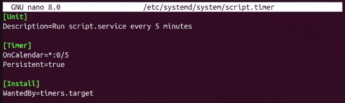
Далее обновляем конфигурацию (daemon-reload), включаем таймер в автозагрузку (enable script.timer) и запускаем юнит прямо сейчас (start script.timer). И в конце проверяем работу при помощи (status script.timer):
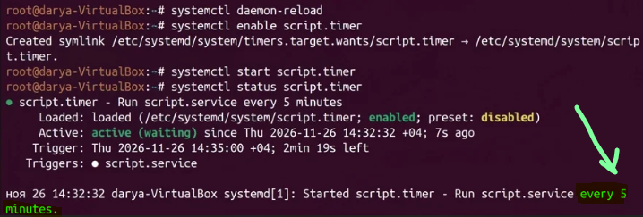
### 4) От какого пользователя по умолчанию выполняются системные units?
По умолчанию systemd-юниты запускаются от пользователя root.
### 5) Создайте отдельного пользователя для выполнения вашего скрипта.
Создадим нового пользователя new:
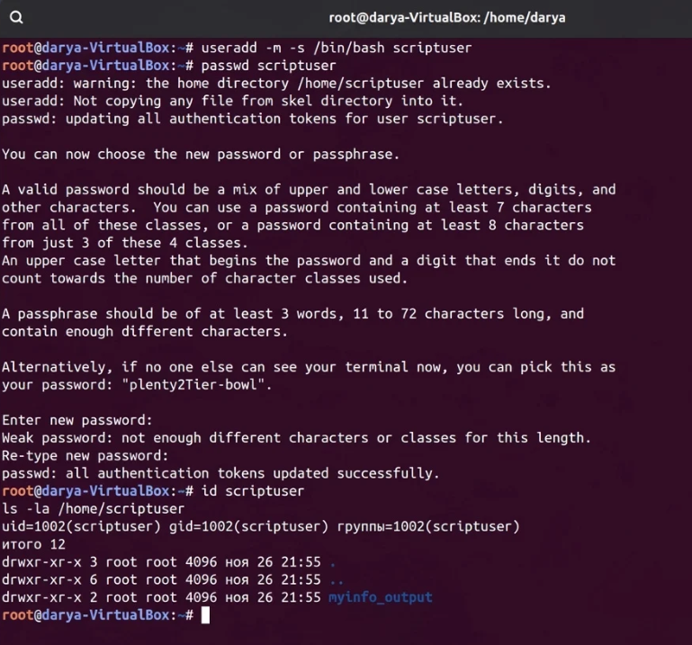
### 6) Дополните unit так, чтобы скрипт выполнялся от созданного пользователя.
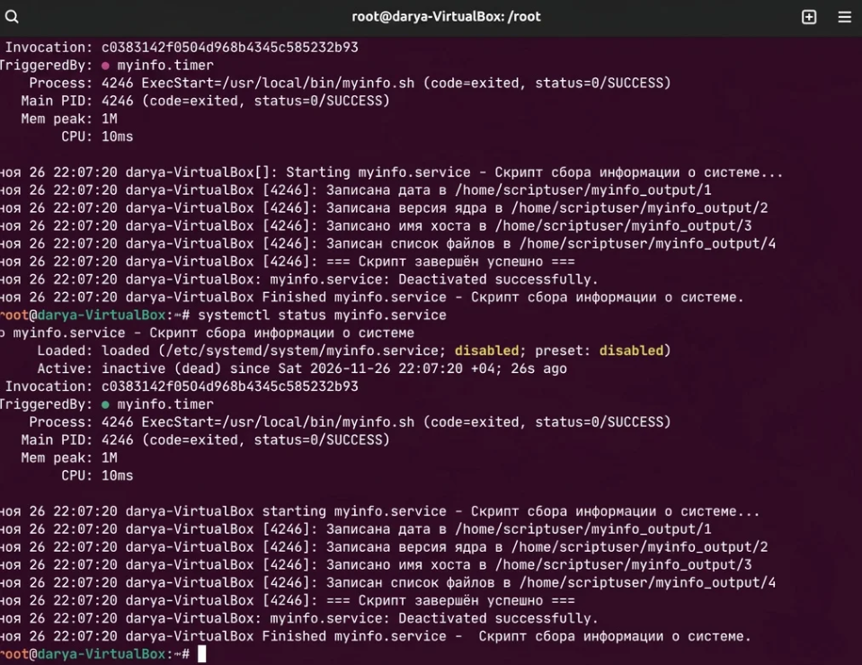
После добавления User=scriptuser и Group=scriptuser в unit-файл, сервис выполняется от имени пользователя scriptuser.

Файлы создаются в его домашнем каталоге /home/scriptuser/myinfo_output/. Статус сервиса после выполнения — inactive (dead)
### 7) Дополните скрипт так, чтобы он независимо от текущего каталога выполнял работу в домашнем каталоге пользователя, от которого запущен.
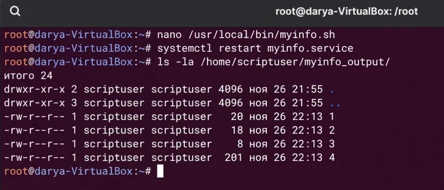
### 8) Определите PID процесса во время выполнения, если он успевает существовать достаточно долго.

```shell
myinfo.sh[4277]   ← PID = 4277
myinfo.sh[4292]   ← PID = 4292
myinfo.sh[4315]   ← PID = 4315
```
Каждый запуск сервиса создаёт новый процесс со своим уникальным PID
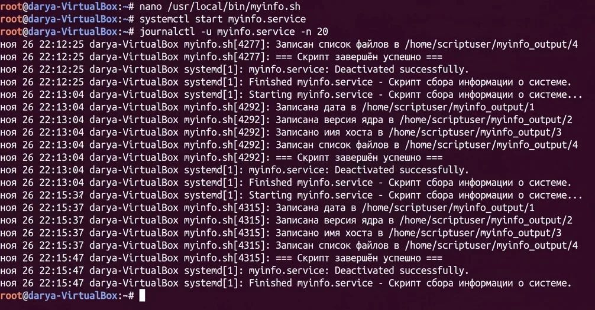
### 9) Найдите в journal записи о запуске service.
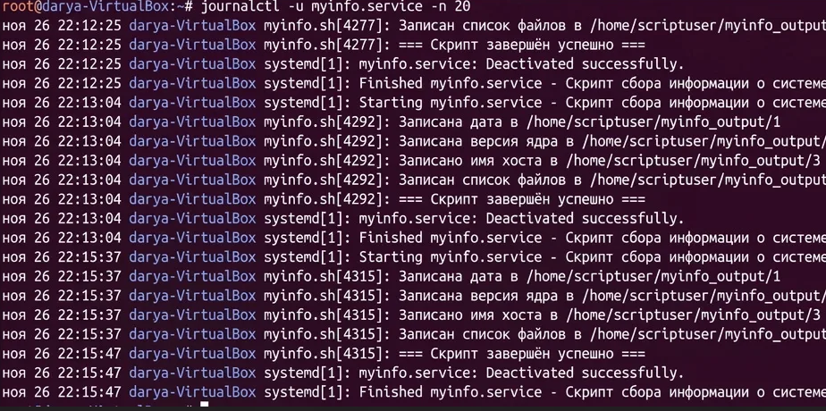
### 10) Намеренно внесите ошибку в скрипт или unit, добейтесь состояния `failed`, определите причину через `systemctl` и `journalctl`, затем исправьте.
Ошибка несуществующего файла
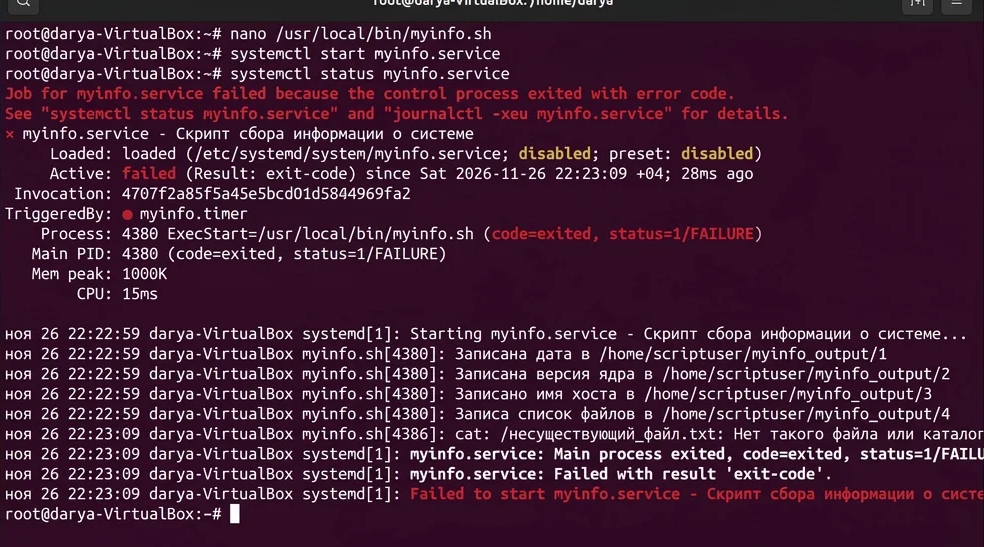
Диагностика через journalctl
```shell
sudo journalctl -u myinfo.service -n 10

myinfo.service: Failed with result 'exit-code'.
Failed to start myinfo.service
```
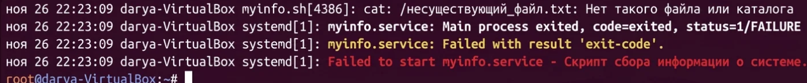
Диагностика через systemctl
```shell
systemctl show myinfo.service | grep -E 'Result|ExitStatus|ExecMainStatus'

Result=exit-code
ExecMainStatus=1
```
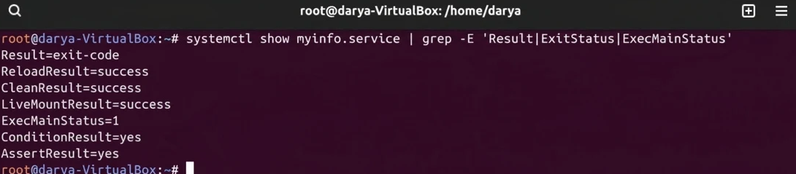
Исправляем
```shell
Main PID: 4422 (code=exited, status=0/SUCCESS)
```
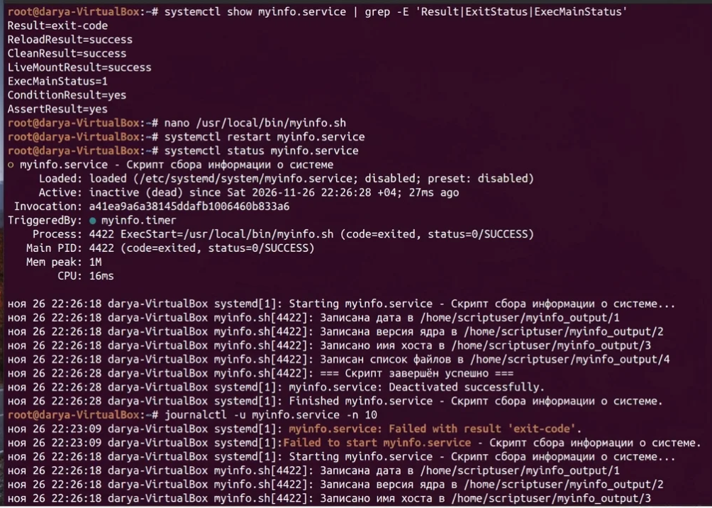
