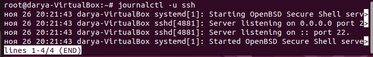
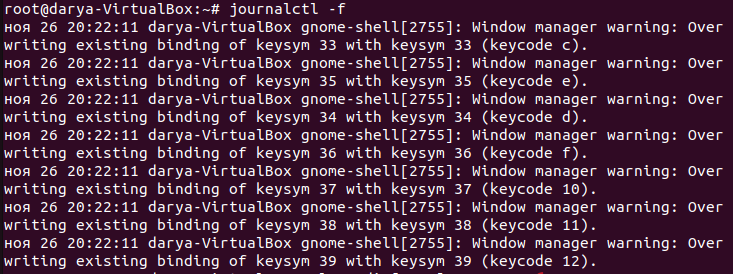
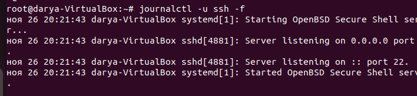
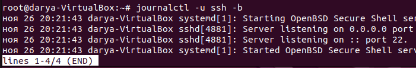
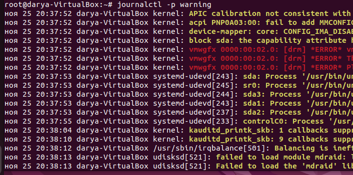
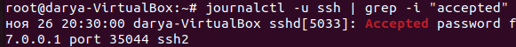

# Журналы

### 1) Посмотрите журнал службы SSH.
Выводим при помощи команды journalctl -u sshd:
Для просмотра всех записей, связанных со службой SSH используем флаг -u

### 2) Выведите журнал системы в реальном времени.
Флаг -f (follow) показывает новые записи по мере их появления

### 3) Выведите в реальном времени журнал только службы SSH.
Выводим при помощи команды journalctl, флаг -f показывает события журнала в момент их появления, -u sshd

### 4) Отфильтруйте журнал службы SSH за текущую загрузку системы.
Флаг -b (boot) ограничивает вывод записями только с момента последней загрузки компьютера

### 5) Покажите сообщения не ниже уровня `warning`.

### 6) Можно ли получить доступ к журналам systemd без команды `journalctl`? Где journald хранит данные и почему это не обычный текстовый лог?
Прямо прочитать их как обычный текст нельзя, так как это бинарный формат. Однако доступ можно получить через программный API systemd, с помощью утилиты strings, которая может вытащить читаемые строки из бинарного файла (но без структуры и метаданных), экспортировав журнал в текстовый вид: journalctl --output=export или --output=json.

В режиме постоянного хранения (persistent): /var/log/journal/ (в подпапках с идентификатором машины). В режиме временного хранения (volatile, если /var/log/journal не создан): /run/log/journal/ (данные стираются при перезагрузке).

Каждая запись содержит метаданные (PID, UID, приоритет, точная временная метка, имя хоста), а не просто строку текста. Бинарный формат позволяет мгновенно фильтровать данные по любому полю (например, по PID или времени) без перебора всего файла. Журналы автоматически сжимаются и могут быть криптографически подписаны для защиты от подделки задним числом.
### 7) Найдите в журнале событие собственного подключения по SSH.

### 8) Сколько будет 2 - 2?
0...